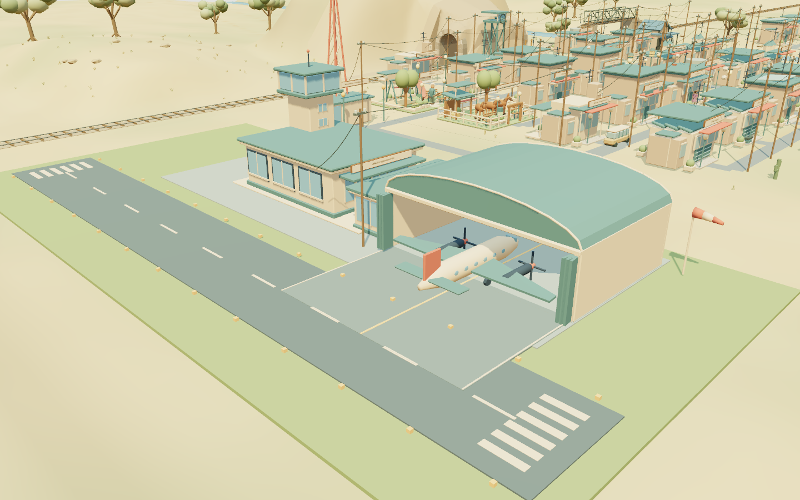
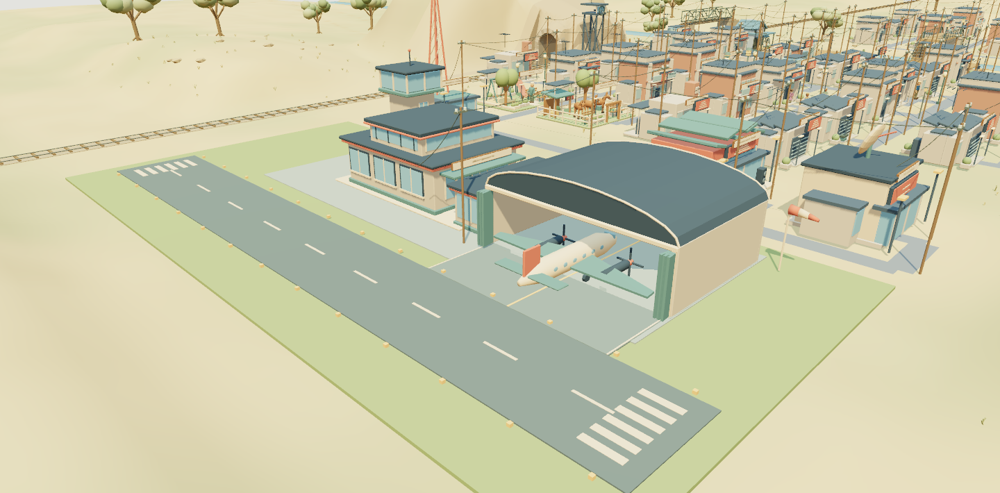
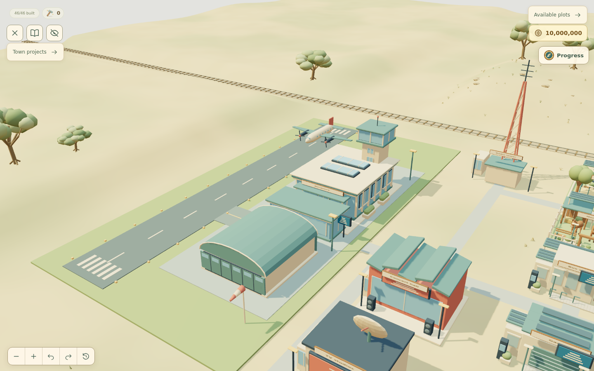
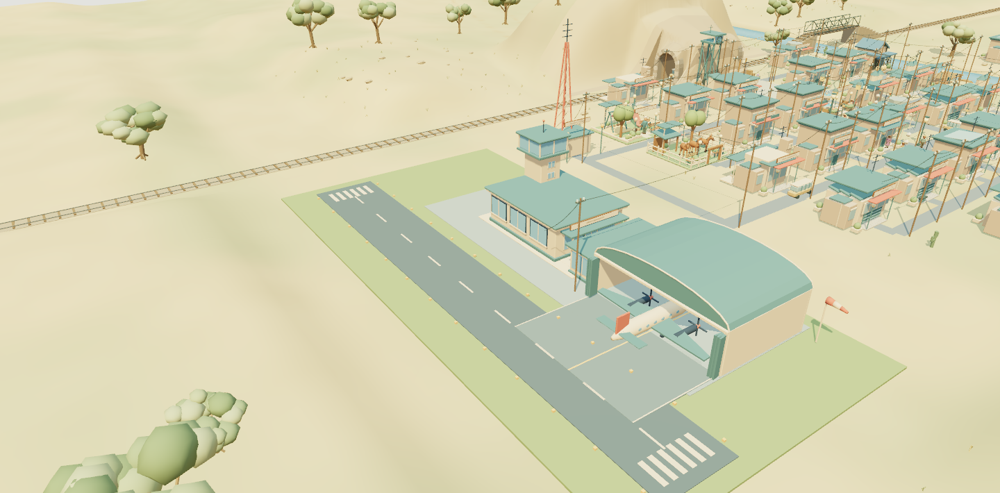
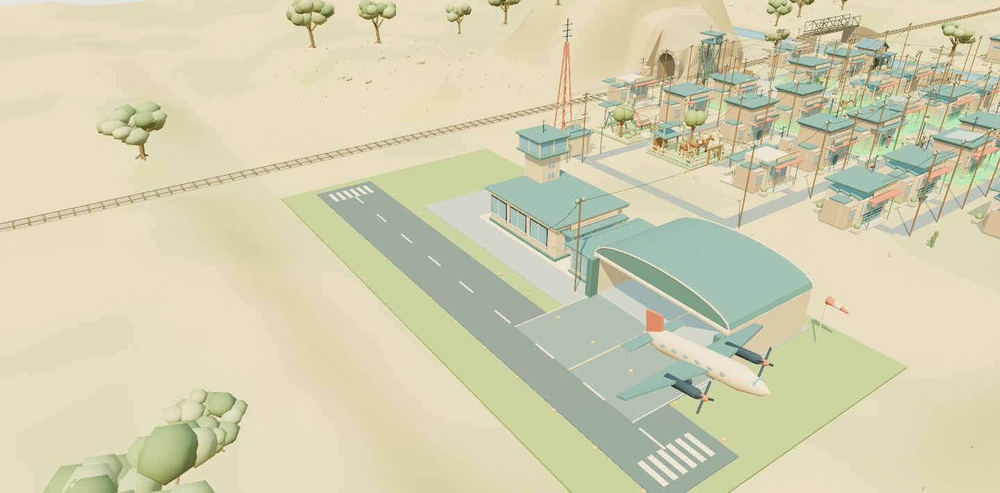
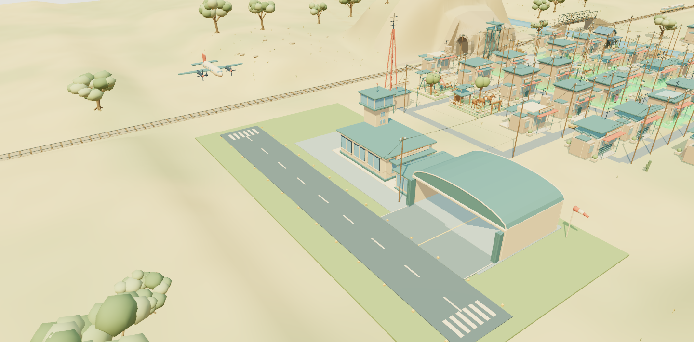

# Airport visual refresh

The airport retains the town's muted cream, teal, coral and blue-glass palette,
soft edges and compact architectural proportions. A faceted barrel roof with
flat end walls replaces the inflated elliptical hangar. Framed terminal windows,
an integrated control tower, a sheltered entrance, grass verges and a restrained
forecourt replace the disconnected blocks and continuous paved slab.

The airport's completed modernization era selects its architecture. The town
entering an era does not replace an airport that has not yet been modernized.
The hangar is rotated 90 degrees so its open end faces west toward the runway.
Separate side and rear walls, folded doors, a flush floor and a wide marked
taxiway leave room for the actual aircraft at every upgrade stage. The stage 2
passenger lounge stays north of that route. The apron and its markings stop at
the runway edge, preserving the full runway surface and centerline. `src/data/airportLayout.json` shares
the hangar orientation and parking position between Blender and flight activity.

The airport's stages depend on how it is built:

- **Native build.** Building the airport in its own era keeps the original three
  tiers: the terminal/tower/hangar, the passenger lounge, then landscaping, apron
  lights and windsock. Later styles also gain a departures board.
- **Modernizing airport.** In a later era the airport keeps its completed terminal
  wing and rooftop observation lounge from finish level 1, through the shared
  `buildingStages()` `structureLevel`. The hangar geometry and opening and
  `airportLayout.json` are unchanged.
- **Paid finish level 2** adds a supported observation clerestory. In the rounded eras
  (Tomorrow onward) this is a capsule seated on the roof.
- **Paid finish level 3** enlarges or completes that clerestory or capsule. It never
  removes or rebuilds the wing or the lounge.
- **Grounds and décor** continue on the existing era hooks, and the existing windsock is
  retained.

The table below describes the native-build stages.

| Era                      | Architecture                                                             | Triangles at stages 1 / 2 / 3 |
| ------------------------ | ------------------------------------------------------------------------ | ----------------------------- |
| Aviation & Radio, 1958   | Low cream terminal, teal roof, framed control cabin                      | 3,052 / 3,324 / 3,804         |
| Music & Television, 1986 | Stepped departure hall, dark roof, coral fascia and upper window ribbon  | 3,352 / 3,624 / 4,236         |
| Connected City, 2005     | Glass terminal, slim vertical fins, light roof cap and glazed rooflights | 3,512 / 3,784 / 4,396         |

These are indexed runtime mesh counts for the airport, including its site and
completed additions, excluding the separately animated aircraft and text sign.
They are not a frame-time performance claim. The site coordinates,
runway alignment, construction costs, rewards and unlimited puzzle moves are unchanged.

`airportStyle` in the era catalog selects a definition in
`src/data/airportStyles.json`. Blender authoring, Three.js and the SVG fallback
share that definition; unsupported styles fall back to the regional airport.
See [the era architecture guide](era-architecture.md) for extension rules.

Rebuild through Blender with
`--background --python scripts/create-future-assets.py -- /absolute/repository/path`.
The editable scene, GLB and actual source-mesh review sheet are in `art/future/`;
the game uses `src/assets/future-meshes.json`.

One aircraft runs a four-minute sequence (`src/game/town/TownAviation.js`): a
parked interval, a departure, a quiet interval, then an arrival back at the hangar.
Arrival and departure are phases of the same controller, so they cannot run
simultaneously. Visitors step out when the aircraft docks at 176 seconds into the
cycle, whatever it flies. The normal reduced-motion setting still applies.

The screenshots use the actual game renderer. Regression coverage checks the
exported hangar exit volume against the aircraft's wingspan and height through
all nine era/stage combinations, plus flight continuity, terrain clearance and
one-aircraft ownership throughout repeated cycles.

## 1958

## 1986

## 2005

## Aircraft activity

The airport's completed modernization era picks the aircraft, as it picks the
architecture: the plane named by `airportStyles.json` (`aircraft`), or the sky saucer
when the era's `transportStyle` is `rounded` (Tomorrow City onward). Both fly the same
cycle and the same arrival time, but with different profiles.

### Planes

The plane pushes back, taxis to the runway threshold, lines up, rolls and climbs away,
fading out. It returns on a straight approach along the runway, rolls out and taxis back.
It crosses the railway only during its airborne approach, with clearance checked against
the landscape and train corridor.

Each visit flies a slightly different plane, chosen from the visit index
(`airplaneFlight()`), so the choice is deterministic and survives town rebuilds:

- **Livery.** Each airport style lists `liveries` for its accent colour (`liveryAccent`,
  the tail fin and, on the 1958 propeller plane, the spinners). The first entry is the
  authored colour. 1958: coral, period blue, mustard. 1986: teal, coral, navy. 2005:
  teal, sky blue, apricot.
- **Departure.** `PLANE_DEPARTURES` varies the rotation point and the climb rate. One
  profile also makes a gentle banked turn away from the town once the plane is well
  clear of the ground. The first profile is the original departure.

The plane changes identity while it is out of sight, so the plane that lands is the one
that parks and leaves on the next visit. Liveries cycle with the visit, and departures
shift every full livery cycle: consecutive visits always differ in both, and nine visits
fly every pairing. Every variant uses the same model, so it fits the hangar.

[Two 1958 plane visits, 30 fps](images/airport/plane-visits-30fps.mp4): the coral
livery on the original departure, then the mustard livery on the banked-turn departure,
whose turn begins as it leaves the frame.

### Sky saucer

The saucer needs no runway. It lifts a little off the hangar floor and folds its legs,
hovers out along the same hangar taxiway the planes use, and stops on a pad on the runway
beside the hangar door. Its rim lights spin up and it wobbles slightly. It lifts straight
up, pauses in a hover, then accelerates away and fades, leaving a sparkle wake. Landing mirrors
this: it appears high, slows to a hover above the pad, descends vertically, settles and
hovers back into the hangar, where its legs come down. Below hover height it is always
over the hangar taxiway or straight above the pad, clear of every road, path, the
railway and the station.

#### Sparkle wake

As the saucer leaps off the hover, a star-flash bursts open where it was: a halo star in
the era's trait colour opens wide and fades, around a brief, stronger centre in a deeper,
more saturated shade of that colour, turned 45° so the burst has eight points. Then a
stream of small four-point twinkles is shed from the hull's trailing edge along its path,
drifting apart and sinking as they twinkle and fade, while the saucer flies on. Arriving
mirrors it: the flash marks where it drops in, and the twinkles follow it down to the
hover. The wake is depth-tested against the hull, so the saucer hides any star behind it,
but writes no depth, so the stars never hide each other.

The wake is carried by the era's trait colour (or the rim, when the trait colour is the
light itself), so it reads against the pale sky, with the era's `light` for every other
twinkle. On the Moon route a moonlit blue-silver (`TRAIL_SILVER`) takes the trait
colour's place. `src/game/town/SaucerTrails.js` draws it as one mesh with its own geometry
and material: 18 stars (16 twinkles and the two flash stars), 72 triangles, written in
world space every frame into buffers allocated once. It is one instanced draw while it
shows and none while the saucer is parked or away, so the saucer stays within its vehicle
budget of 15 meshes. With reduced motion the wake stays off; the flight is unchanged.

The saucer evolves with the airport's era. `SKY_SAUCERS` in `src/data/skyCraft.js` is
the one definition: each era takes its colours from its own palette and adds one small
trait of at most two meshes (`SAUCER_TRAITS` in `RoundedTransports.js`).

| Airport era  | Colours                                 | Trait                                                 |
| ------------ | --------------------------------------- | ----------------------------------------------------- |
| Tomorrow     | `ROUNDED_PALETTE` cream, teal and glass | None: the base saucer                                 |
| Canopy       | Canopy cozy palette, sage rim           | A pair of leaves on the dome                          |
| Riverlight   | Riverlight cozy palette, lavender rim   | A lavender crystal finial and a garden ring           |
| Skysail      | Skysail palette, deep teal rim          | A saffron sail fin and pennant at the stern           |
| Stargazer    | Night-blue hull, copper rim             | A copper dome band and a star on top                  |
| Moonward     | Moon-white ceramic, gold rim            | A gold dome band and landing beacon                   |
| Twin Hollows | Twin palette, gold rim                  | Twin lanterns, teal for the valley, gold for the Moon |

An era without an entry flies the Tomorrow saucer, and an unknown trait draws nothing.
Twin Hollows does not modernize the airport (it is not in that era's `modernizes`
list), so a real Twin Hollows town keeps a Moonward airport and flies the Moonward
saucer. The Twin Hollows saucer and its twin lanterns therefore never show in a normal
game today; the entry only applies to an airport in the Twin Hollows era, such as a
synthetic test town or a later change that modernizes the airport. A new rounded-transport
era needs an entry: `testing/airport-flight.test.js` fails until it has one.

**To the Moon.** The saucer heads for the Moon when the airport's era supplies the Moon
settlement (the era's `moonSettlement` capability: Moonward and later) and the valley
sky shows the Moon (`skyMoonShown()`: New Hollow has homesteads once the space elevator
is built). The era capability makes it a Moon shuttle; the sky check guarantees it never
flies toward a Moon that is not drawn, for example from a Moonward airport finished
before the space elevator. The route is fixed for each visit while the saucer is parked,
so a Moon that appears mid-flight never bends a flight already in the air.

On that route it climbs steeply off the hover, then levels onto the line of sight to the
drawn Moon: `SKY_MOON_DIRECTION`, shared with the sky Moon in `TownScene.vue`, about 5°
above eye level. Its path therefore runs into the Moon from any camera. It returns down
the same route. Otherwise it leaves for the open sky, westward and away from the town,
and returns straight down from overhead.

[Sky saucer leaving Tomorrow City, 30 fps](images/airport/saucer-tomorrow-30fps.mp4)

[Moonward saucer leaving for the Moon, 30 fps](images/airport/saucer-moonward-30fps.mp4)

### Earlier stills

