# Skysail, Stargazer, Moonward and Twin Hollows

Four playable eras follow Riverlight. Together they tell one story: the town takes to the
sky, discovers the Moon, then sends its own prospectors to a new frontier, as the
founders did in 1865. The tone stays warm: neighbors, gardens and homecomings.
The Willowkin stay part of every chapter. They tend the floating orchards, know
every star by name and ride the ribbon as seedlings to plant the first Moon
gardens. The garden neighbor's street walks continue into the new Skyward quarter.

| Era         | Year | Saved id    | Architecture  | Story beat                                                            |
| ----------- | ---- | ----------- | ------------- | --------------------------------------------------------------------- |
| Skysail Age | 2185 | `skysail`   | `sail`        | Riverlight glass is light enough to fly; sails and floating orchards. |
| Stargazer   | 2230 | `stargazer` | `observatory` | Domes and a great telescope find crystal glints on the Moon.          |
| Moonward    | 2270 | `moonward`  | `homestead`   | A space elevator beside the mine supplies Moon homesteads.            |

A fourth era, Twin Hollows (2300), takes the town to the Moon; see
[Twin Hollows](#twin-hollows-2300) below.

## Looks that evolve

Each era keeps every building's purpose and massing but gives it a new silhouette:

- **Skysail** — stilted timber decks, sailcloth saddles stretched between masts,
  saffron pennants, kites and little garden islands floating on tethers. Cream,
  saffron and teal. Boardwalk streets and a wind-spiral fountain.
- **Stargazer** — night-blue ceramic walls, copper cornices, starlit arched
  windows and white observatory domes split by a viewing slit; telescopes and
  violet orbit rings crown the finished buildings. Star-path streets and an orrery.
- **Moonward** — the frontier gables return in moon-white ceramic with gold trim,
  navy solar shingles, barn-red porches and round airlock doors; landing beacons
  and dishes crown the finished buildings. Heritage brick streets and the very
  first well, restored under a moon-glass cap.

The renderer is shared. `src/data/futureArchitecture.js` holds the three palettes
(the cozy colour roles, so paint, watermill and SVG consumers read the same keys),
the family → archetype table and the nine landmark forms. `buildings/future.js`
composes the archetypes (homes, hall, shop, workshop, water, station, culture,
research, farm, landing, garden, mast, concert, studio, tower, square) from the
era's kit in `buildings/future/{sail,observatory,homestead}.js`. A kit supplies
`block`, `roof`, `round`, `cap`, `door`, `wing` (level 2), `crown` (level 3) and
`prop`. A later era can reuse a kit or add one without new archetype code. The
unit shapes (gable, tensile saddle, dome, octagon, peak, pennant) are created once
per diorama in `futureShapes.js`. `TownFutureBuilding.vue` draws the same pieces
for the SVG fallback. The city renderer registry dispatches the building, airport
lounge, airport grounds and bridge hooks by architecture.

## New buildings and the Skyward quarter

The garden lane (x = 72) now crosses the railway into the Skyward quarter, two
rows of large lots behind the tracks. The space elevator stands on its own lot
west of the mine hill, reached by a new road between the radio tower and the park
that crosses the railway beside the station.

| Era       | Building           | Effects                    |
| --------- | ------------------ | -------------------------- |
| Skysail   | Sky harbour        | 4 visitors, 2 comfort      |
| Skysail   | Cloud orchard      | 4 food, 4 water, 1 comfort |
| Skysail   | Windsong lofts     | 4 homes, 1 comfort         |
| Stargazer | Great telescope    | 4 visitors, 2 comfort      |
| Stargazer | Dewlight gardens   | 4 food, 4 water, 1 comfort |
| Stargazer | Starlight terraces | 4 homes, 1 comfort         |
| Moonward  | Space elevator     | 6 visitors, 3 comfort      |
| Moonward  | Moonpost           | 2 visitors, 2 comfort      |
| Moonward  | Mission homesteads | 4 homes, 1 comfort         |

Effects scale with each building's level, as for every city building. Prices
continue the Riverlight steps (modernization 13.6k–22k, new buildings 15.5k–24.5k),
and the space elevator carries the major-landmark premium and a two-puzzle first
stage. Town needs tests confirm every finished era houses everyone.

## Optional monument sites

Monument sites open every other era, so of these four eras only Stargazer and
Twin Hollows add one (see [town personalisation](town-personalisation.md#monument-sites)).
Each offers three designs; they are cosmetic, never gate progression and take one
upgrade per later era.

| Era          | Site             | Where                      | Designs                                                       |
| ------------ | ---------------- | -------------------------- | ------------------------------------------------------------- |
| Stargazer    | Stargazers’ Lawn | Beyond the Skyward quarter | Orrery Garden, Comet Arch, Aurora Dome                        |
| Twin Hollows | Homecoming Green | Beyond the Skyward quarter | Twin-lantern Walk, Earth and Moon Garden, Family Welcome Arch |

Prices continue the ladder at 25,000–27,000 and 31,000–33,000. The server replays
each site's purchases from the exported catalog like every other monument.

## The Moon

The default camera looks down at the town, so a moon in the 3D sky would never be
on screen. New Hollow is therefore a small Moon chip beside water, food and
happiness. `moonSettlement(town)` in `src/data/moonSettlement.js` counts two
homesteads per elevator level plus one for every four modernization levels in a
supply era (the `moonSettlement` capability), up to 24. Each homestead is a gold
light that twinkles out of step; reduced motion keeps them still. Tapping the chip
opens the space elevator. In the 3D town the elevator's climbers ride the ribbon
up and down with supplies (a moving part like the watermill wheel, outside animal
collision). The settlement is presentation only: no coins, timers or failure.

## Rules kept

- No move limits, timers or puzzle changes; mine levels for these eras are a
  separate pass.
- Honours: the three eras join `NON_MILESTONE_ERAS`. A Through the Ages diamond
  rank ("Two Towns, One Sky") is reserved for the Twin Hollows era.
- The mine surface keeps Riverlight's lantern-lit works; each era adds its own portal
  crown (`sail-arch`, `dome-arch`, `homestead-arch` in `MineFutureArchitecture.js`),
  so every era transition visibly rebuilds the mine.

## Gallery

Completed towns from the `<era>-complete` demo fixtures (`npm run demo:eras`),
rendered in headless Chromium with SwiftShader at 1440 × 900.

The same old-town view, from Riverlight to Moonward:

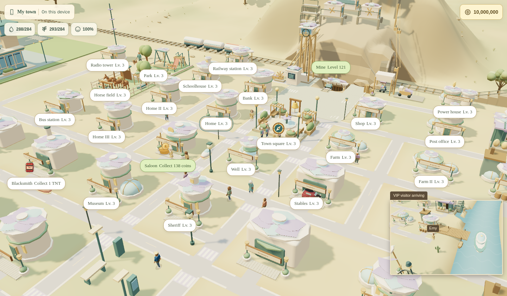
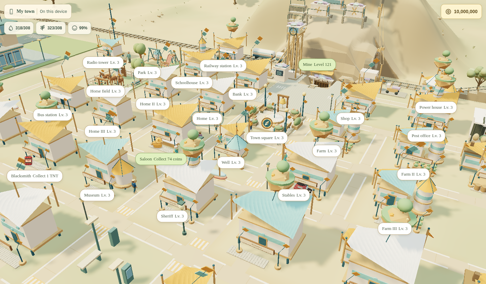
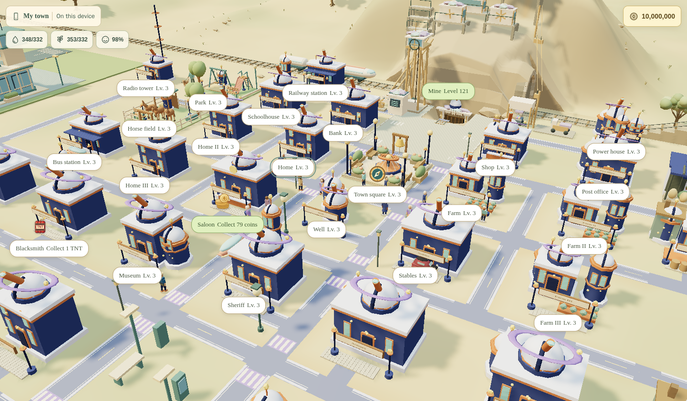
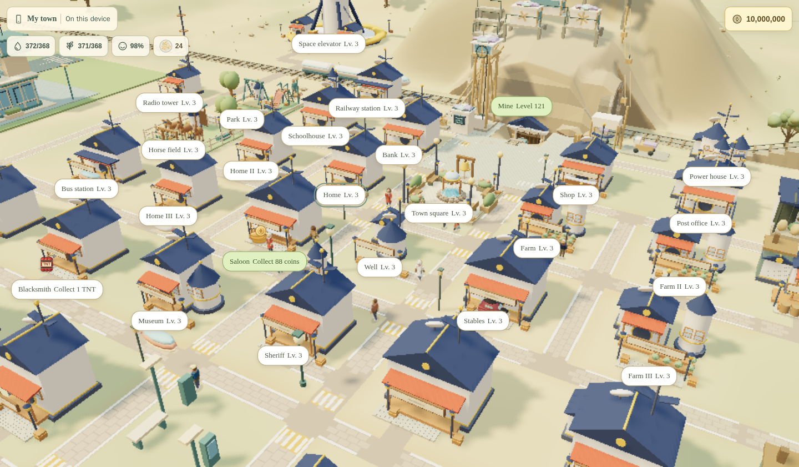

The Skyward quarter beyond the railway:

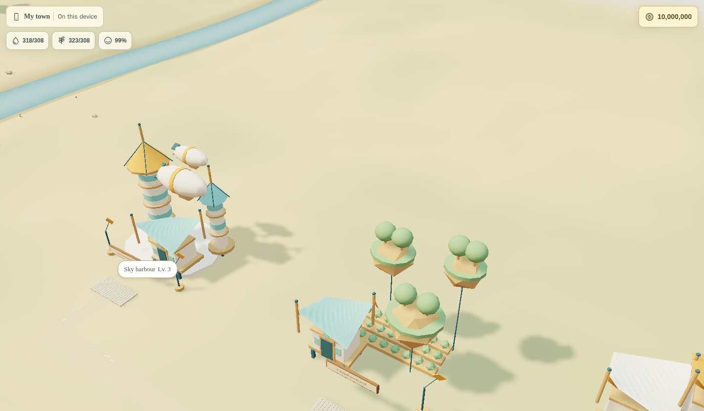
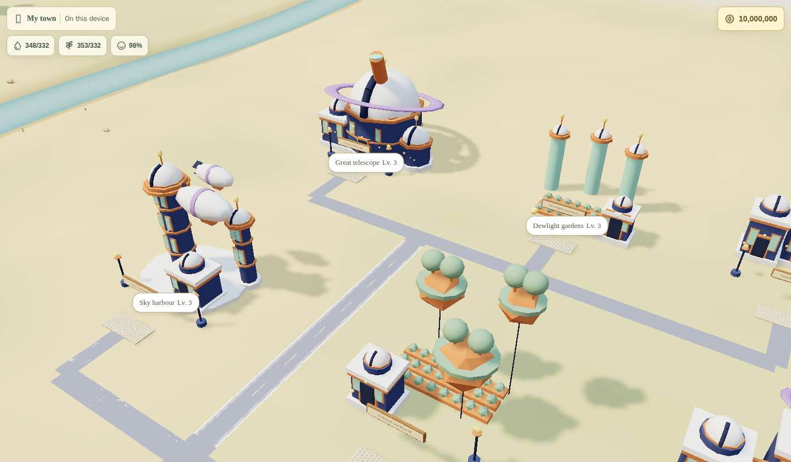
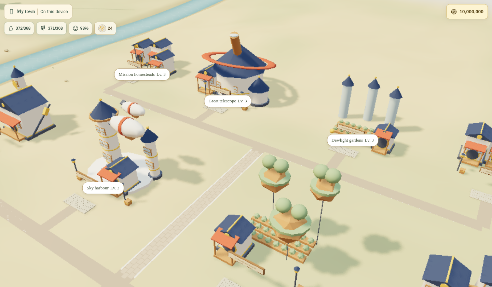

Each era crowns the mine portal in its own style:

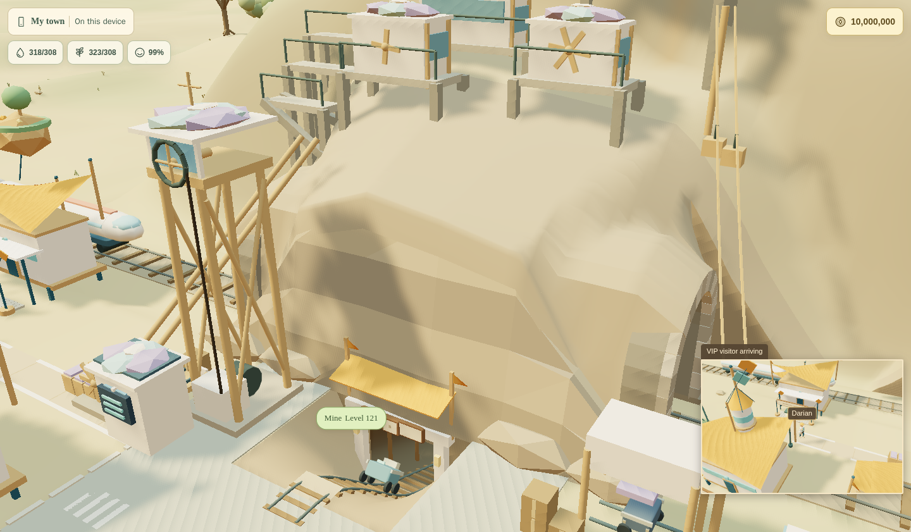
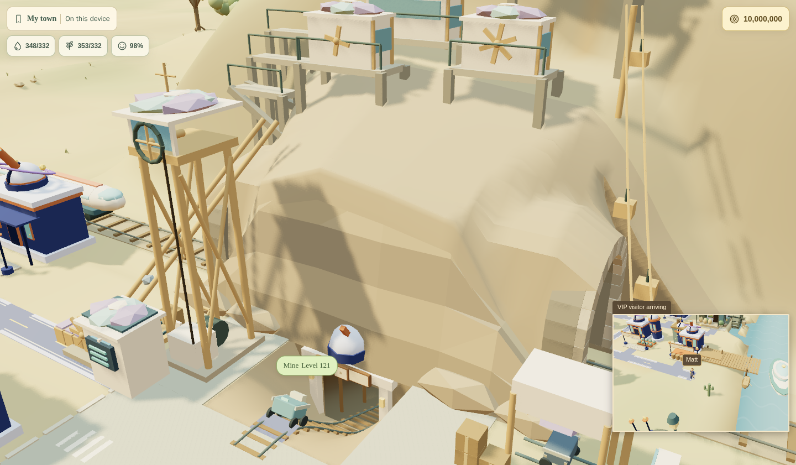
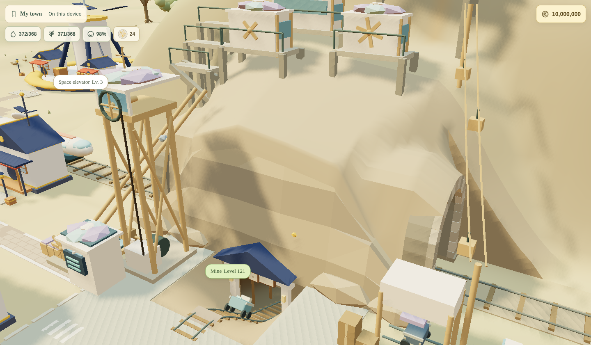

The space elevator beside the mine, and each finished town:

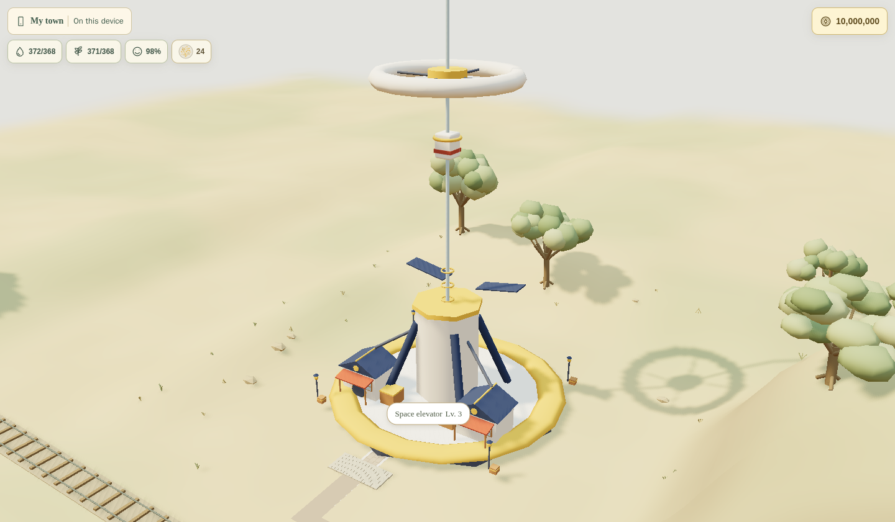
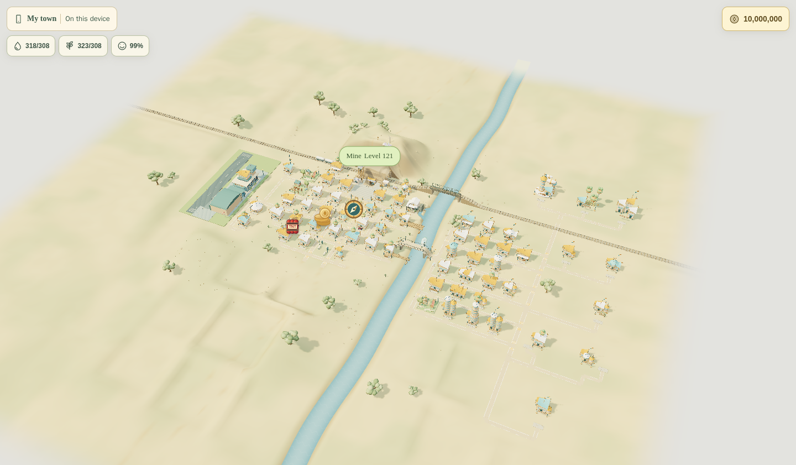
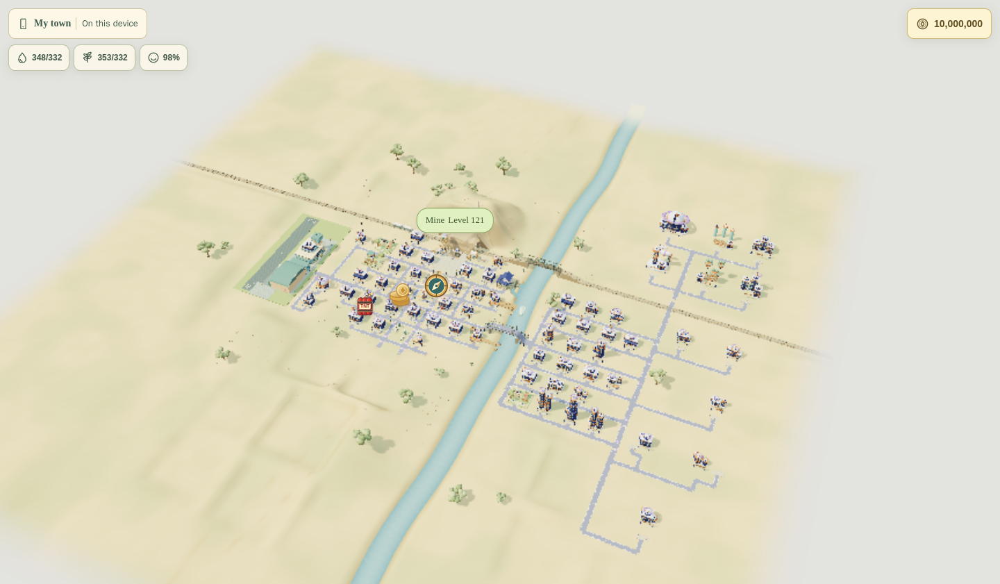
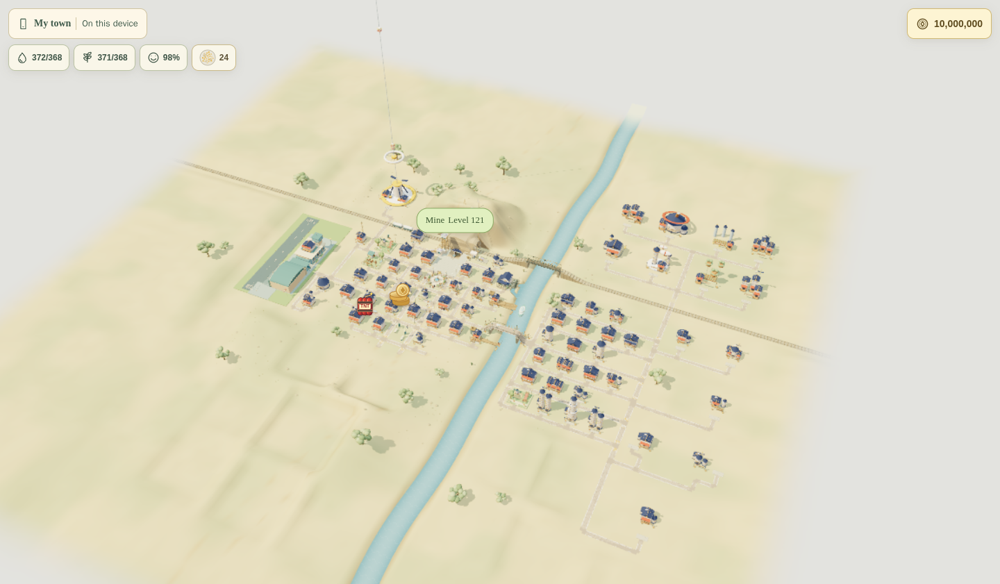

## Twin Hollows (2300)

The Moon is the new frontier. The town now looks after two places: Prospect
Hollow in the valley and **New Hollow** on the Moon. Both share one coin wallet
and a saved moonstone balance for optional monuments or sales. Moon buildings
never fail or decay, and their construction and resource production advance
through puzzle play, not a real-time deadline.

### Light homecoming on Earth

The era's `modernizes` capability lists the only valley buildings it modernizes:
the square, the main well and farm, the station, the space elevator and the
Moonpost. Every other building keeps its Moonward finish and counts as complete
(`modernizesInEra()` and `eraBuildingLevel()` in `TownEras.js`;
`SaveIntegrity::eraComplete()` reads the exported `modernizes` list). A new
homecoming hall stands in the garden district beside the blossom atelier. The
`twin` architecture reuses the homestead kit in softer silver-blue with teal and
gold twin lanterns and an arch carrying a little Earth and Moon; the square gets
the twin-globes fountain and the mine portal a homecoming gable.

### New Hollow

Ten required Moon buildings are ordinary `BUILDINGS` entries flagged `settlement: 'moon'`,
so offers, construction (completed puzzles), needs, saves, server validation and
shared projections all use the existing lifecycle. They have no valley lot:
`EARTH_BUILDINGS`/`MOON_BUILDINGS` in `data/town.js` separate the two, and the
valley renderer, footprints and labels skip Moon buildings.

| Building              | Effects (per level)   |
| --------------------- | --------------------- |
| Ribbon landing        | 4 visitors, 1 comfort |
| Settler domes         | 6 homes, 1 comfort    |
| Crater ice well       | 12 water, 1 comfort   |
| Earthlight greenhouse | 12 food, 1 comfort    |
| Willowkin garden dome | 2 visitors, 2 comfort |
| New Hollow commons    | 2 visitors, 2 comfort |
| Crater homesteads     | 6 homes, 1 comfort    |
| Moonstone workshop    | 2 visitors, 1 comfort |
| Rover barn            | 2 comfort             |
| Earthrise lookout     | 2 visitors, 2 comfort |

The workshop also produces saved moonstones for collection: 1 / 2 / 3 every
three completed puzzles, storing up to 10 / 20 / 30 at levels 1 / 2 / 3.
[Moonstones](moonstones.md) documents continuous production credits and sales.

Needs are shared: the valley's spare water and food go up the ribbon, so a
well-run valley lets the Moon grow. The era is complete when both are finished.

The Moon also hangs in the valley sky, a round image to the north-west above the
mine and the elevator that drifts across the sky as the camera turns. It shows
when sky is in view (a wide view, or tilted until the horizon shows) and carries
the homestead lights. Tapping it, or the Moon chip beside water, food and
happiness, opens the **Moon map** once Moon buildings are available (`TownMoonView.vue` inside `TownScene`, so shared-town
visitors see it too). `game/town/moon/MoonScene.js` is a small scene of its own:
a crater of lots (`MOON_LOTS`) on smooth rolling regolith with soft craters
(`moonHeight()`), a ring road, the ribbon arriving from the valley, a starfield,
settlers walking and rovers driving the ring, and an occasional meteor (still
under reduced motion). Earth is a painted, round image on a sprite (not a 3D
globe), half risen over the far hills; tapping it returns to the valley. The
valley pauses while the Moon is open, and the Moon view keeps its input from the
valley's camera. A lot button answers like a valley tap (`TownView.selectBuilding`):
it finishes ready construction, collects the moonstone workshop's stock or unveils a
finished monument level first, and otherwise opens the shared building details. Without WebGL
the map falls back to an SVG crater with the same buttons. `buildings/moon.js`
draws the Moon buildings (glass domes on ceramic drums, airlocks, gold foil,
solar fins), and `TownMoonBuilding.vue` draws them for cards and the fallback.

The optional **Saucer Pad** is an eleventh Moon building, unlocked after Ribbon
Landing level 1 and Rover Barn level 1. Its three levels use the shared Twin
Hollows prices (31,500 / 35,250 / 39,000 coins), construction, needs and save
contracts. The first level has a lit landing ring, beacon masts and service
hatch; level 2 adds fuel and cargo, and level 3 a freight canopy and dispatch
beacon. It adds comfort without increasing the settlement’s food or water demand.
It occupies `[15, -30]` with radius 6.4, away from the ring road and
other lots. Its public approach faces inward; the flight corridor climbs outward
to the north-east. There is a matching SVG illustration and letter home; each completed level
grants a saved moonstone.

Once the pad reaches level 1, `MoonSaucer.js` brings a shuttle onto its landing
circle. The 150-second visit approaches from high sky, hovers, settles on
extended legs, stays for 36 seconds, then lifts vertically and departs.
`SkySaucer.js` shares the valley's model, airport-era paint, folding legs and
sparkle wake/flash; Twin Hollows therefore keeps its Moonward craft. Reduced
motion parks it with the wake and dust off. The Moon's existing clock and frame
pacer drive everything; no flight state is saved and construction does not
enable visits until the first level is completed.

The pad explicitly sets `requiredForEraCompletion: false`, preserved by the
shared building factory and exported to the server. It never makes a completed
Twin Hollows save incomplete or gates future progression. Existing Moon buildings
keep their completion requirements and the era's modernization list stays fixed.
The footprint generator covers `EARTH_BUILDINGS` only; the Moon's shared lot radii
and approach geometry cover this pad. Honours version 5 adds the bronze Shuttle
Host rank for its first completed level. Its levels also count toward New Hollow
Pioneer; its building gifts count toward Lunar Keepsake Collector. These use the
shared building-level and lifetime-resource measures without changing earlier
shipped requirements.

`testing/moon-saucer.test.js` checks built visibility, palette fallback, grounded
feet within the octagonal pad, flight clearance against finished buildings,
road/path clearance, reduced motion and resource disposal.
`testing/browser/moon-saucer.cjs` captures the unbuilt pad, approach, touchdown,
take-off and close-ups with the render loop stopped. Run it with the Docker
browser setup of the [Moon input check](#moon-input-check) (substitute its
filename), with `PH_SCREENSHOT_DIR` set to an output directory (default
`/tmp/moon-shots/saucer`). `PH_CAPTURE_VIDEO=1` additionally
writes numbered PNG frames under `frames/`; encode them at 10 fps with ffmpeg
for an accelerated visit with the long parked interval shortened.

#### Moon input check

As in the valley, the Moon's camera gestures (`createTownControls`) and taps share one
surface, the canvas's parent, which also holds the lot labels and action buttons: a
drag from a label orbits, and a tap on one settles through the shared tap gesture
(keyboard activation still works). The header with **Back to the valley** sits outside
that surface. Moon input still reaches the document (Escape closes sheets, a press
unlocks audio); the valley's camera is covered while the Moon is open and its tap
gesture ignores the Moon view. The letters from New Hollow are in the Story tab, not
on the map. `testing/browser/moon-input.cjs` clicks and taps them with a mouse and
with touch, checks that no letters overlay is drawn, drags the orbit (from the canvas
and from a label), taps Earth and checks the valley never reacts. CI does not run
it. Run it after changing Moon input or its overlays, then stop the server:

```bash
docker run -d --rm --name hollow-moon-web --user "$(id -u):$(id -g)" -e HOME=/tmp -p 127.0.0.1:8192:8192 -v "$PWD":/app -w /app node:24-bookworm-slim npm run dev -- --host 0.0.0.0 --port 8192 --strictPort
docker run --rm --network host --user "$(id -u):$(id -g)" -e HOME=/tmp -v "$PWD":/app -w /app mcr.microsoft.com/playwright:v1.55.0-noble sh -c 'npm i --no-save --silent --prefix /tmp/pw playwright@1.55.0 && PLAYWRIGHT_MODULE=/tmp/pw/node_modules/playwright node testing/browser/moon-input.cjs'
docker stop hollow-moon-web
```

On the host network, Chromium drops in-flight module requests
(`ERR_NETWORK_CHANGED`) whenever another container starts, which leaves a blank page
and a timeout. If other containers are busy, replace `--network host` with
`--network container:hollow-moon-web` to share the server's own network.

`testing/browser/moon-labels.cjs` uses the same Docker browser setup. Substitute
that filename in the second command to check WebGL and SVG at 1440×900, 900×360
and 375×740. It checks visible labels for overlap, screen bounds, attachment to
projected buildings, touch/keyboard selection, English/French text overflow and
finish icons that remain tappable with names hidden. Set `PH_SCREENSHOT_DIR` to
save captures. `testing/browser/town-label-parity.cjs` compares computed styling
in both real map components across sizes, languages and interaction states.

Both maps use `TownMapLabel.vue` for the complete pill: inline name/status,
typography, colours, selection, focus, hover, press and responsive sizing.
`TownLabelLayout.js` keeps each name at its projected building and hides lower
priority names when they overlap or do not fit. `TownLabels.js` supplies priority,
distant-detail and composited DOM movement. Selection and work take precedence;
routine names disappear at distant zoom and return when zooming in. They do not
move into vacant slots or change into dots. The Build tab still lists every lot,
and every 3D parcel remains tappable with labels on or off.

Map adapters supply projected coordinates and header/footer clearance. Moon SVG
projection accounts for the centred, letterboxed viewBox and uses the same layout.
Portrait framing preserves orbit and relative zoom. Action icons remain separate
from text and reserve their own space, so a hidden name never hides its finish or
collection button. Cinematics hide the controls.

`PH_TEST_ORIGIN` points the check at another server.

Each finished Moon building level grants **one saved moonstone**. The workshop
produces more for collection; stones can be sold or spent on the optional
Moonstone Garden in the valley and Moonrock Court on the Moon. Earthrise Plaza
uses coins. See [Moonstones](moonstones.md) for production, storage, continuous
play, prices and migration from the original cosmetic keepsakes. **Letters home**
remain cosmetic, one per finished Moon building, derived by `moonLetters()`
without a separate saved reward. Moon guests ride down the elevator: it is a
visitor transport like the train, boat and plane, publishing an arrival each
time a climber reaches the docks.

The Willowkin stay in the story: the garden dome raises the first Willowkin born
on the Moon, and the valley's Willowkin neighbors keep their walks.

Honours: Through the Ages gains its diamond rank, **Two Towns, One Sky**
(complete Twin Hollows, goal 29, introduced in honours version 3). Honours
version 5 adds New Hollow Pioneer, Shuttle Host, Lunar Keepsake Collector and
Landmark Patron, plus continuous-play families and shared gem, fusion and mine
mastery credit. Resource earnings and puzzle gems remain separate measures; see
[Town Honours](honours.md) for the fixed ranks and calibration.

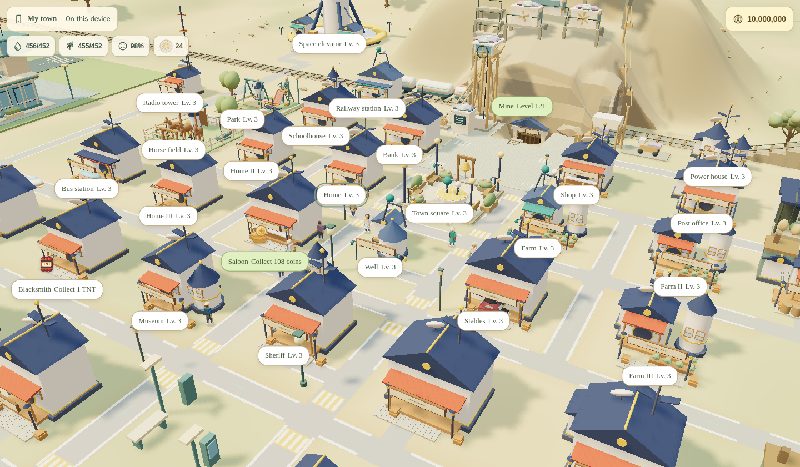
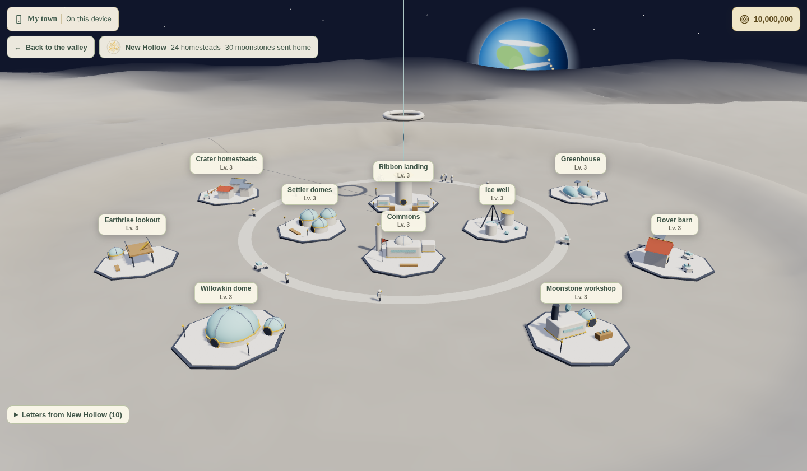
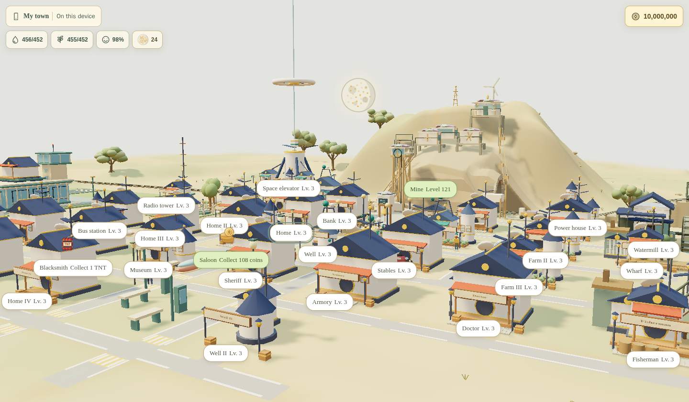

For current monument sites, designs and construction, see
[town personalisation](town-personalisation.md). The former-site captures have been retired.
