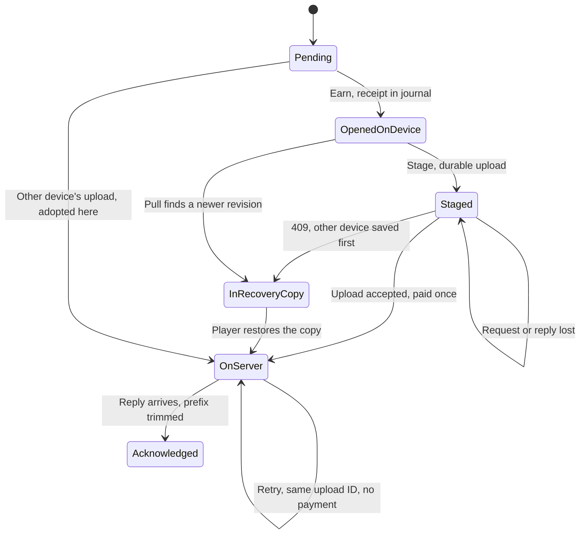

# Rewards across save sync

**Property:** the server pays each chest at most once, whatever lost replies, retries and a second device do, and a chest the player opened is never silently lost. If this broke, players would get duplicate rewards or lose ones they earned.

**Tool:** TLC from `tla2tools.jar` v1.7.4, run in Docker by `bash scripts/check-models.sh` (about three minutes). The jar downloads to `.cache/` on first use, and its checksum is verified. CI doesn't run it. Run it when `syncService.js`, `saveIntegrity.js` or `SaveService::transact` change how uploads, acknowledgments or conflicts work.

## Guarantees

| Invariant               | Meaning                                                                         |
| ----------------------- | ------------------------------------------------------------------------------- |
| `AtMostOnce`            | The server pays out each chest at most once                                     |
| `SettledMeansPaid`      | A chest the server has settled was paid exactly once                            |
| `NothingSilentlyLost`   | An opened chest is on the server, on its way, or in that device's recovery copy |
| `AckNeverAhead`         | A device never believes more was acknowledged than the server replayed          |
| `JournalsContiguous`    | Journals have no gaps, so a replay can't skip a receipt                         |
| `RevisionsCountUploads` | A retry never advances the revision                                             |

## How it maps to the code

| Model                 | Code                                                             |
| --------------------- | ---------------------------------------------------------------- |
| `Earn`                | `campaignStore` claiming a chest, `appendIntegrityAction`        |
| `Stage`               | `syncTown` then `stage` in `src/services/syncService.js`         |
| `Upload`              | `upload` and `SaveService::transact`, handled as one atomic step |
| `IsRetry`             | The `upload_id` check in `transact`                              |
| `Stale`               | The `baseRevision` check in `transact`, answering 409            |
| `replayable`          | `SaveIntegrity`: replay starts from the anchor's `baseSequence`  |
| `new` minus `claimed` | `chest-claim` needing the chest in `pendingChests`               |
| `Acknowledged`        | `accept` and `acknowledgeIntegrity`                              |
| `AcknowledgedLagging` | The in-memory journal before `mergeIntegrity` catches it up      |
| `Adopt`               | `conflict`, with `preserve` writing the recovery copy            |
| `Pull`                | `syncTown`'s GET finding a newer revision                        |

## Assumptions and exclusions

- A server request is one transaction, as it is under the row lock. A request that never arrives is simply no `Upload` step.
- Only chest-like rewards are modelled: a chest exists once in the shared starting profile, and both devices can try to open it. Income, shop and other receipts aren't modelled.
- A running puzzle delaying a conflict (`canApply`), player-chosen restores and overwrites (`resolve`), corrections, `keepHonours`, guest journal compaction and epoch rotation aren't modelled. A restore can legitimately return an old state, so it isn't a duplication question here.
- Bounds: two devices, two or three chests, up to four staged uploads. A pass says nothing beyond these.

The real-code side of these guarantees: `backend/tests/save-integrity.php` ("already acknowledged action cannot apply twice", second chest claim rejected), `backend/tests/saves.php` ("same upload gets same revision", "corrected lost response retry") and `testing/integrity-sync.test.js` (lost acknowledgment retried exactly, only the uploaded prefix acknowledged).

## Evidence

Checked against `preprod` on top of `5df3b7b2`. Update this when the transitions above change.

| Config                                              | Result                                                                                                          |
| --------------------------------------------------- | --------------------------------------------------------------------------------------------------------------- |
| `pass-three-uploads`                                | Holds, 23,025 distinct states                                                                                   |
| `pass-four-uploads`                                 | Holds, 50,885                                                                                                   |
| `pass-three-chests`                                 | Holds, 3,200,146                                                                                                |
| `pass-anchor-only`                                  | Holds with the entitlement check removed, 23,025                                                                |
| `pass-entitlement-only`                             | Holds with the anchor check removed, 23,025                                                                     |
| `mut-replay-everything`                             | Must fail: `AtMostOnce` violated                                                                                |
| `mut-conflict-loses-progress`                       | Must fail: `NothingSilentlyLost` violated                                                                       |
| `mut-ack-without-reply`                             | Must fail: `NothingSilentlyLost` violated                                                                       |
| `mut-server-ignores-revision`                       | Must fail: `NothingSilentlyLost` violated                                                                       |
| `reach-conflict`, `reach-retry`, `reach-same-chest` | Must fail, proving conflicts, retries of an accepted upload and both devices opening one chest are all explored |

## What it found

No game bug. Worth knowing: double payment is protected twice. The anchor skips receipts already replayed, and a chest claim needs the chest to be pending. Either alone holds in this model; removing both pays twice. Keep both, because only chests rely on the second one here.

The revision check is what protects a second device's progress. Without it the anchor check silently drops that device's receipts, so rewards vanish rather than duplicate.

## States

One chest on two devices. The chart merges device states that behave the same.

**Shortest failure, with `mut-conflict-loses-progress`:**

1. Device 1 opens a chest.
2. Device 2 opens a different chest and uploads it.
3. Device 1 stages its upload and receives a 409.
4. Device 1 adopts the cloud copy without saving a recovery copy. Its chest is gone. `NothingSilentlyLost` breaks.
